# Digital Signal Processing

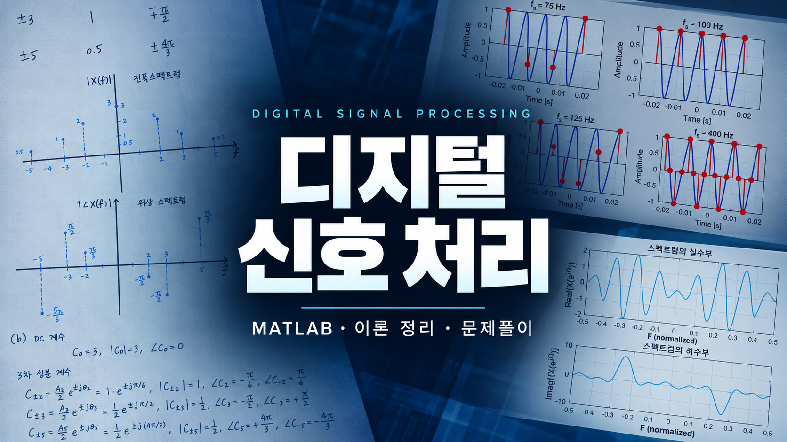

디지털신호처리를 공부하며 작성한 MATLAB 실습과 개념 정리, 문제풀이를 모아둔 저장소입니다.
신호에서 시작해 컨벌루션, 샘플링과 양자화, 푸리에 해석 순서로 정리했습니다.
각 실습은 하나의 스크립트로 되어 있고, 실행 결과는 [Resources](Resources) 폴더에 있습니다.

## Contents

- [신호](#신호)
- [컨벌루션](#컨벌루션)
- [샘플링과 양자화](#샘플링과-양자화)
- [푸리에 해석](#푸리에-해석)
- [문서](#문서)

## 신호

모든 이산 신호는 시간 이동한 임펄스의 가중합 x[n] = Σ x[k] δ[n − k]로 표현할 수 있습니다.
기본 신호와 잡음의 세기를 나타내는 SNR은 [개념 정리](Docs/개념%20정리.md#2-신호)에 정리했습니다.

### 기본 이산 신호

−10 ≤ n ≤ 10 범위에서 임펄스 δ[n], 계단 u[n+5], 사각 펄스 rect[n/8], 램프 0.2·r[n−3], sinc(n/3), 지수 감쇠 정현파 e−0.15ncos(0.2πn)u[n]을 그렸습니다.

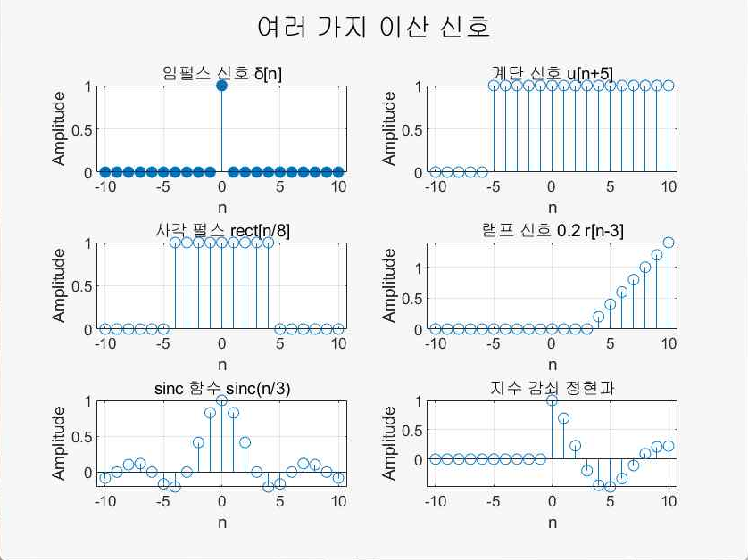

계단과 램프는 시간 이동이 그래프에서 어떻게 나타나는지 보여 줍니다. u[n+5]는 n = −5부터 1이 되고, r[n−3]은 n = 3부터 증가합니다.
sinc(n/3)은 n = 0에서 1이고, 3의 배수인 n에서 0이 됩니다.

[DiscreteSignals.m](01_Signals/DiscreteSignals.m)

### 잡음 섞인 신호

정현파 s(t) = cos(2πt)에 평균이 0인 균일분포 잡음과 정규분포 잡음을 각각 원하는 SNR로 섞었습니다.
잡음 크기는 a = σs / (σn · 10SNR/20)으로 정하고, 균일분포는 15 dB, 정규분포는 10 dB로 맞췄습니다.

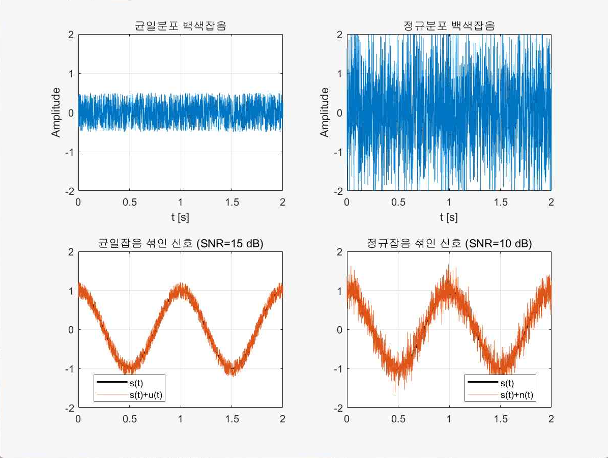

잡음 원본은 정규분포 쪽이 훨씬 크지만, 섞을 때 a로 크기를 맞추므로 결과의 흔들림은 목표 SNR로 정해집니다.
SNR이 5 dB 낮은 정규분포 쪽이 원 신호 주변에서 더 크게 흔들립니다.

[NoisySignal.m](01_Signals/NoisySignal.m)

## 컨벌루션

LTI 시스템은 임펄스 응답 h[n] 하나로 기술되고, 출력은 입력과 임펄스 응답의 컨벌루션 y[n] = x[n] * h[n]입니다.
시스템의 성질과 FIR, IIR 구분은 [개념 정리](Docs/개념%20정리.md#3-시스템)에 정리했습니다.

### 연속 컨벌루션과 이산 컨벌루션

같은 모양의 신호를 연속과 이산으로 정의하고 컨벌루션을 비교했습니다.

- 연속: x(t) = u(t+2) − u(t−2), h(t) = (−t+3)[u(t) − u(t−3)]
- 이산: x[n] = u[n+2] − u[n−3], h[n] = (−n+3)[u[n] − u[n−3]]

연속 컨벌루션은 `conv` 결과에 dt를 곱해 적분을 근사하고, 결과의 시간 축이 2·t(1)에서 시작하므로 원래 t 구간에 해당하는 부분만 잘라냈습니다.

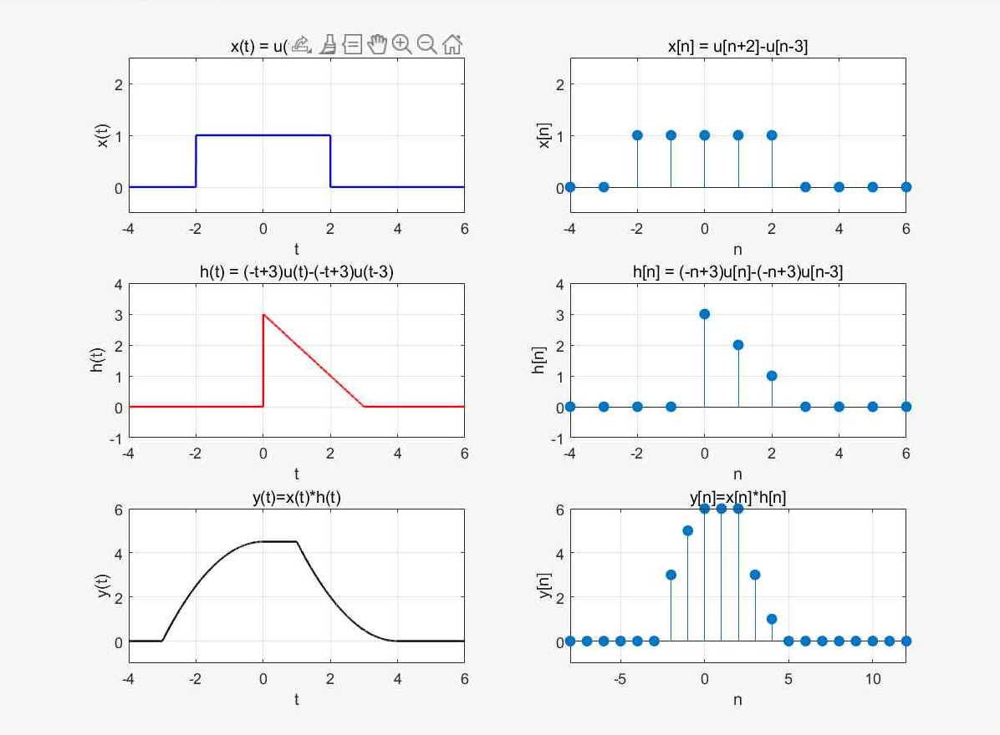

x가 h를 완전히 덮는 구간에서 출력이 가장 크고, 그 값은 h의 넓이와 같습니다.
연속에서는 h(t)의 넓이 4.5, 이산에서는 h[n]의 합 3 + 2 + 1 = 6입니다.

[Convolution.m](02_Convolution/Convolution.m)

### 이동평균 필터

송신 신호 s[n] = (1.02)n에 주기 8인 잡음 v[n] = 0.5 cos(2πn/8 + π/4)가 더해진 수신 신호 x[n]을 7점 이동평균 필터 h[n] = (1/7) Σk=06 δ[n−k]로 걸렀습니다.

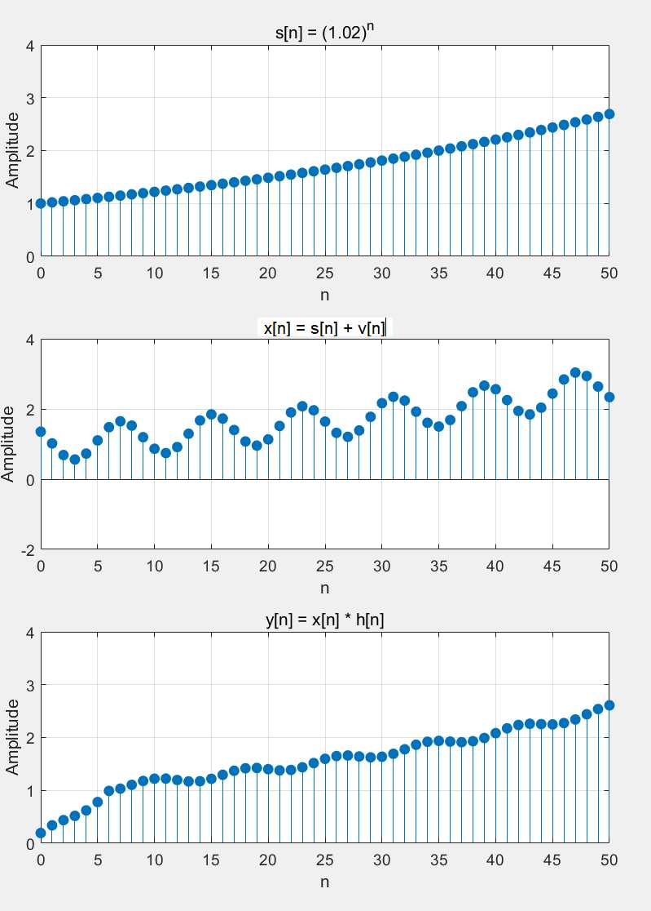

필터 출력 y[n]에서 주기 8의 진동이 크게 줄고 s[n]의 증가 추세가 남습니다.
처음 6개 샘플은 필터 창이 아직 다 채워지지 않아 0에서부터 올라옵니다.

[MovingAverageFilter.m](02_Convolution/MovingAverageFilter.m)

## 샘플링과 양자화

샘플링 주파수가 신호 최고 주파수의 두 배보다 커야 반복된 스펙트럼이 겹치지 않고 원 신호를 복원할 수 있습니다(나이퀴스트 샘플링 정리).
에일리어싱과 양자화 오차는 [개념 정리](Docs/개념%20정리.md#4-샘플링과-양자화)에 정리했습니다.

### 샘플링과 에일리어싱

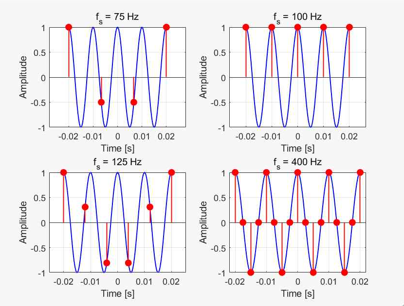

100 Hz 정현파를 fs = 75, 100, 125, 400 Hz로 샘플링한 결과 ([Sampling.m](03_Sampling/Sampling.m))

100 Hz 정현파 x(t) = cos(2π·100t)를 fs = 75, 100, 125, 400 Hz로 샘플링했습니다.
시간 영역 결과는 맨 위 그림이고, 아래는 각 샘플 열을 FFT(N = 1024)로 변환한 진폭 스펙트럼입니다. 순서는 왼쪽 위부터 75, 100, 125, 400 Hz입니다.

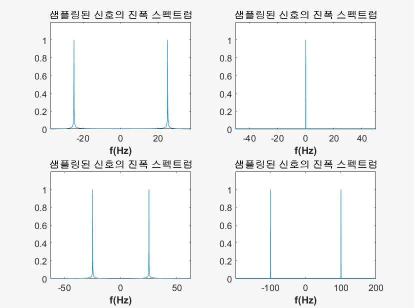

나이퀴스트 주파수 200 Hz보다 낮은 75 Hz와 125 Hz에서는 100 Hz 성분이 ±25 Hz로 접혀 나타납니다.
100 Hz에서는 매 주기 같은 위상에서 샘플링되므로 직류(0 Hz)로 보입니다.
400 Hz에서만 ±100 Hz에 원래 주파수가 나타납니다.

[Sampling.m](03_Sampling/Sampling.m) · [SamplingSpectrum.m](03_Sampling/SamplingSpectrum.m)

### 양자화

정현파 x(t) = sin(2πt)를 한 주기에 100개 샘플로 샘플링한 뒤 3비트로 양자화했습니다.
양자화 간격은 Δ = R / 2b = 2 / 8 = 0.25이고, xq[n] = Δ · round(x[n] / Δ), 오차는 e[n] = xq[n] − x[n]입니다.

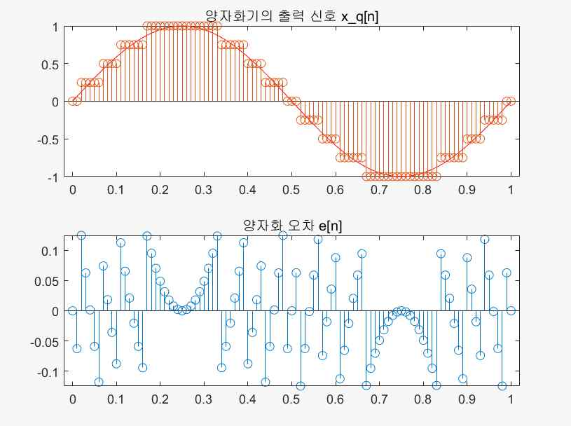

출력은 Δ 간격의 계단 모양이고, 오차는 ±Δ/2 = ±0.125 범위 안에 있습니다.
정현파의 꼭대기 부근처럼 신호가 천천히 변하는 구간에서는 오차도 천천히 변합니다.
SNR = 10 log10(Σx² / Σe²)을 계산하면 약 20.2 dB입니다.

[Quantization.m](03_Sampling/Quantization.m)

## 푸리에 해석

신호가 주기적인지, 시간 영역이 연속인지 이산인지에 따라 FS, DTFS, FT, DTFT 네 가지 변환을 씁니다.
DFT는 DTFT의 한 주기를 N개 점으로 샘플링한 것이고, FFT는 이를 빠르게 계산하는 알고리즘입니다.
네 변환의 관계는 [개념 정리](Docs/개념%20정리.md#5-푸리에-해석)에 정리했습니다.

### 푸리에 변환을 이용한 컨벌루션

사각 펄스 x(t) = u(t+1) − u(t−1)에 대해 y(t) = x(t) * x(t)를 두 가지 방법으로 계산했습니다.
하나는 시간 영역에서 직접 컨벌루션하고, 다른 하나는 컨벌루션 성질 Y = X · X를 이용해 FFT로 곱한 뒤 IFFT로 되돌렸습니다.

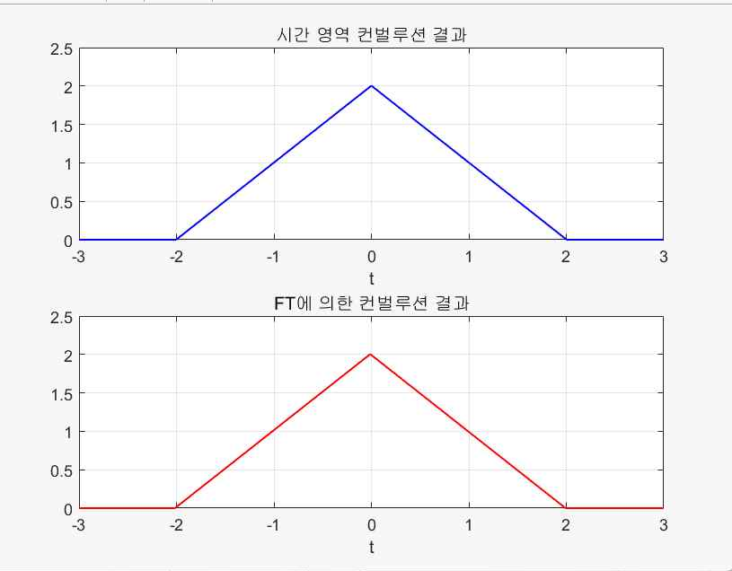

두 방법 모두 −2 ≤ t ≤ 2에서 높이 2인 삼각 펄스가 나옵니다.

[ConvolutionByFT.m](04_FourierAnalysis/ConvolutionByFT.m)

### 이산 시간 푸리에 급수

주기 N = 18인 이산 주기 신호의 한 주기(n = −8 ~ 9)를 정의하고, X[k] = (1/N) Σ x[n] e−j(2π/N)kn으로 DTFS 계수를 구했습니다.

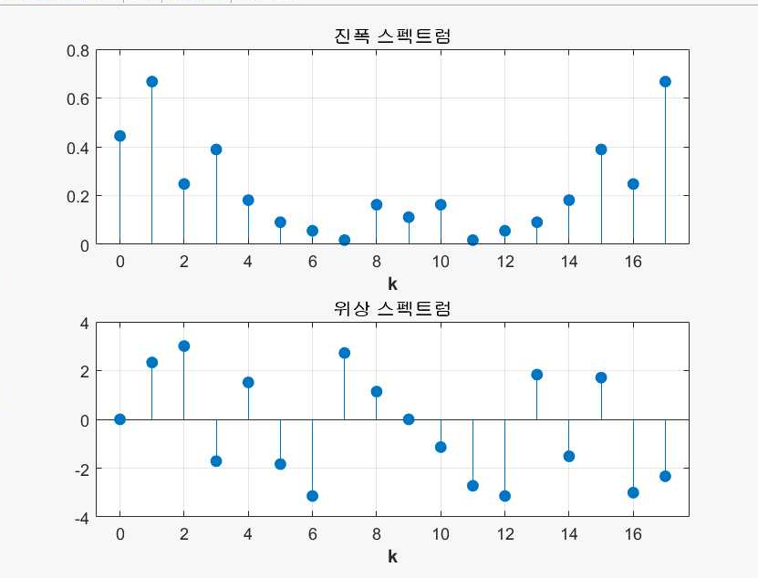

실수 신호이므로 진폭 스펙트럼은 |X[k]| = |X[N−k]|로 대칭이고, 위상 스펙트럼은 부호가 반대인 대칭입니다.

[DTFS.m](04_FourierAnalysis/DTFS.m)

### DTFT와 역변환

주기 신호의 한 주기를 비주기 신호로 보고, 길이 1024로 영채우기한 뒤 FFT로 DTFT 스펙트럼을 근사했습니다.
DFT는 주기적이므로 n < 0 구간의 값은 FFT 배열의 뒤쪽에 배치했습니다.
그다음 IFFT로 시간 영역 신호를 복원하고 n = −10 ~ 10 순서로 다시 배열했습니다.

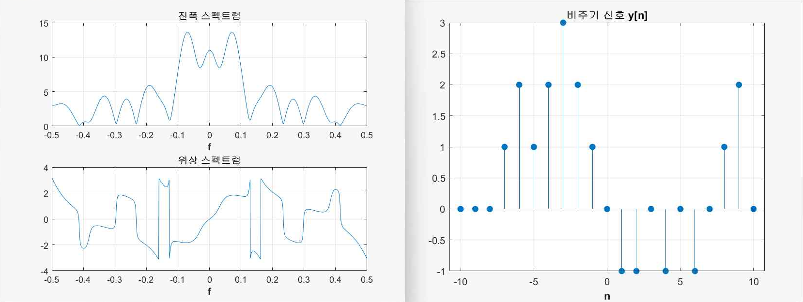

영채우기 덕분에 스펙트럼이 연속 곡선처럼 촘촘하게 나타납니다.
오른쪽의 복원한 y[n]은 n = −8 ~ 9에 처음 정의한 값이 그대로 돌아오고, 나머지 구간은 0입니다.

[DTFT_Inverse.m](04_FourierAnalysis/DTFT_Inverse.m)

### DTFT의 대칭성

비주기 신호 x[n] = sin(πn/2), −5 ≤ n ≤ 10의 DTFT를 행렬 곱으로 계산해 실수부와 허수부를 그렸습니다.

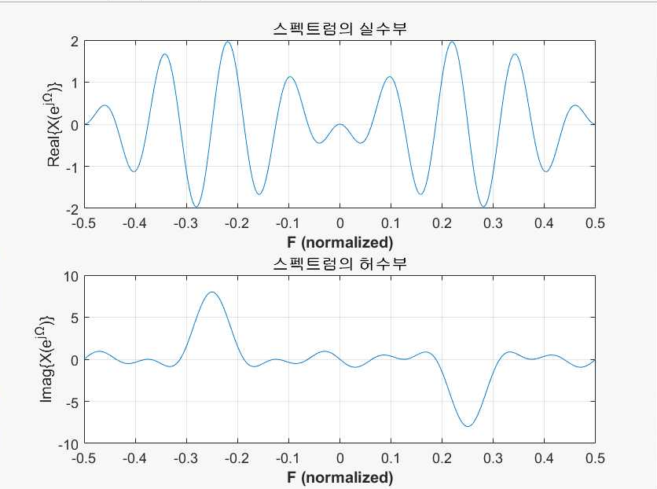

실수 신호이므로 실수부는 우대칭, 허수부는 기대칭입니다. 허수부는 sin(πn/2)의 주파수인 F = ±0.25에서 크게 나타납니다.

이어서 x[n]을 원점 대칭인 축(−10 ≤ n ≤ 10)으로 옮긴 뒤 우함수 성분 xe[n]과 기함수 성분 xo[n]으로 나누고, 각 성분의 DTFT를 구했습니다.
Re{X} = DTFT{xe}, j·Im{X} = DTFT{xo} 관계를 확인하기 위한 실습입니다.

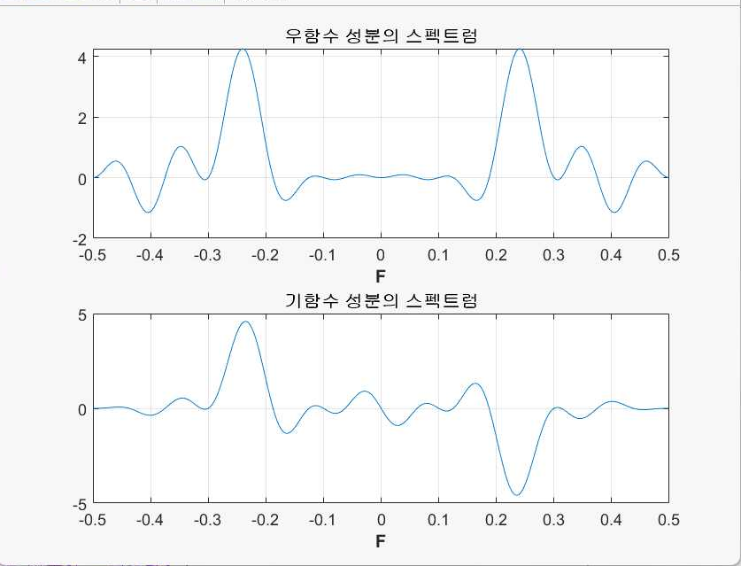

[DTFT_Symmetry.m](04_FourierAnalysis/DTFT_Symmetry.m)

### DTFT의 주파수 이동

x[n] = sin(πn/2)에 ejπn/4를 곱한 y[n]의 스펙트럼을 x[n]의 스펙트럼과 비교했습니다.
주파수 이동 성질에 따라 Y(ejΩ) = X(ej(Ω − π/4))입니다.

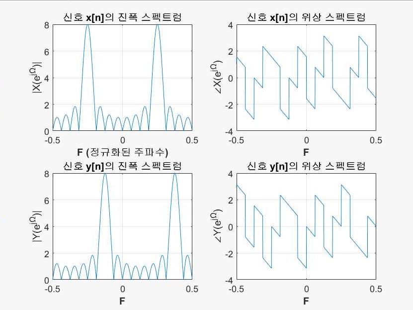

x[n]의 진폭 스펙트럼 봉우리는 F = ±0.25에 있고, y[n]에서는 F = −0.125와 0.375로 옮겨졌습니다.
정규화 주파수로 π/4 / 2π = 0.125만큼 이동한 것이고, 봉우리 모양은 그대로입니다.

[DTFT_FrequencyShift.m](04_FourierAnalysis/DTFT_FrequencyShift.m)

### 원형 컨벌루션

길이 8인 두 신호 x[n] = [1 1 2 1 0 −1 −2 −1], h[n] = [1 1 2 3 2 3 2 1]로 DFT와 원형 컨벌루션의 관계를 확인했습니다.

먼저 원형 컨벌루션을 두 방법으로 계산했습니다.
시간 영역에서는 선형 컨벌루션 결과를 길이 8로 접어 yN[n] = y[n] + y[n+8]로 더하고, 주파수 영역에서는 IDFT(DFT{x} · DFT{h})를 계산했습니다.

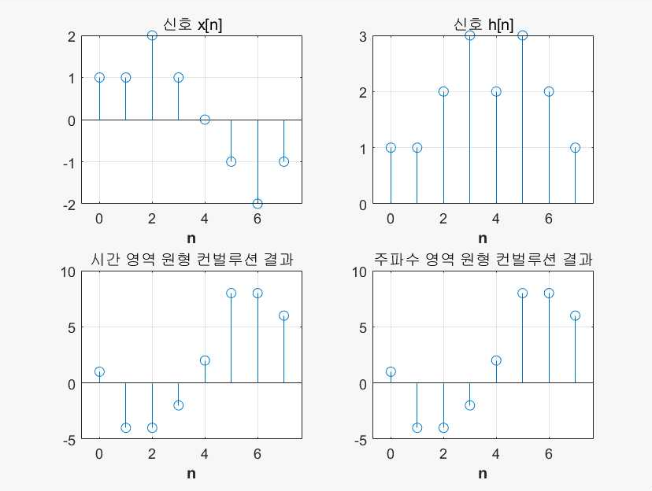

두 결과는 [1 −4 −4 −2 2 8 8 6]으로 같습니다.

다음으로 두 신호를 길이 Nx + Nh − 1 = 15로 영채우기한 뒤 원형 컨벌루션을 계산해 직접 계산한 선형 컨벌루션과 비교했습니다.

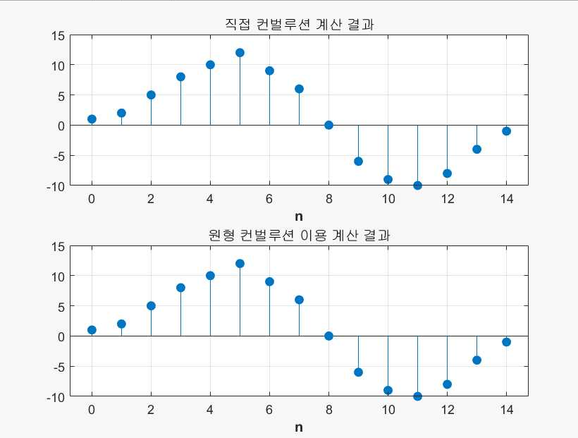

길이가 충분하면 접히는 부분이 없으므로 원형 컨벌루션이 선형 컨벌루션과 같아집니다.

마지막으로 두 신호를 각각 두 번 이어 붙여 주기를 16으로 늘린 원형 컨벌루션을 계산했습니다.

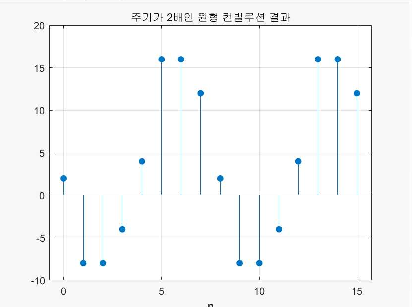

결과는 [2 −8 −8 −4 4 16 16 12]가 두 번 반복됩니다. 길이 8의 원형 컨벌루션 결과를 두 배 한 값이 두 주기 이어진 것입니다.

[CircularConvolution.m](04_FourierAnalysis/CircularConvolution.m)

## 문서

- [개념 정리](Docs/개념%20정리.md): 수업 노트를 실습 순서에 맞춰 다시 정리한 문서
- [푸리에 급수와 푸리에 변환 보고서](Docs/푸리에%20급수와%20푸리에%20변환%20보고서.pdf): 직교 기저에서 푸리에 급수와 푸리에 변환을 유도하고 둘의 차이를 정리한 보고서
- 문제풀이: 교재 연습문제 손풀이
  - [CH2](Docs/문제풀이/CH2%20문제풀이.pdf)
  - [CH3](Docs/문제풀이/CH3%20문제풀이.pdf)
  - [CH4](Docs/문제풀이/CH4%20문제풀이.pdf)
  - [CH5](Docs/문제풀이/CH5%20문제풀이.pdf)
  - [CH6-7](Docs/문제풀이/CH6-7%20문제풀이.pdf)
