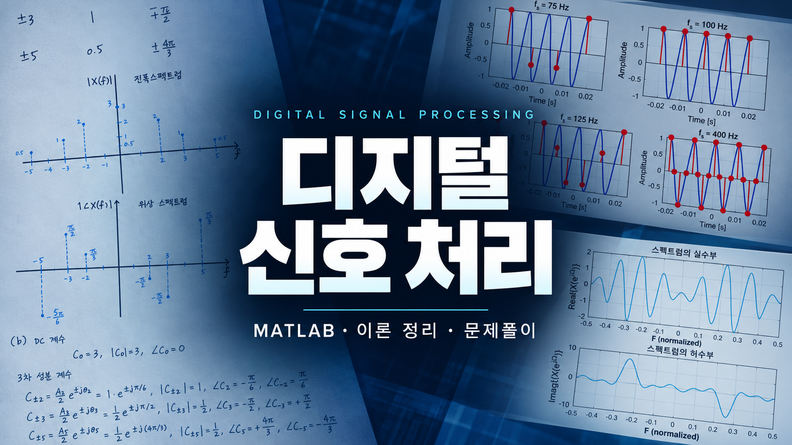
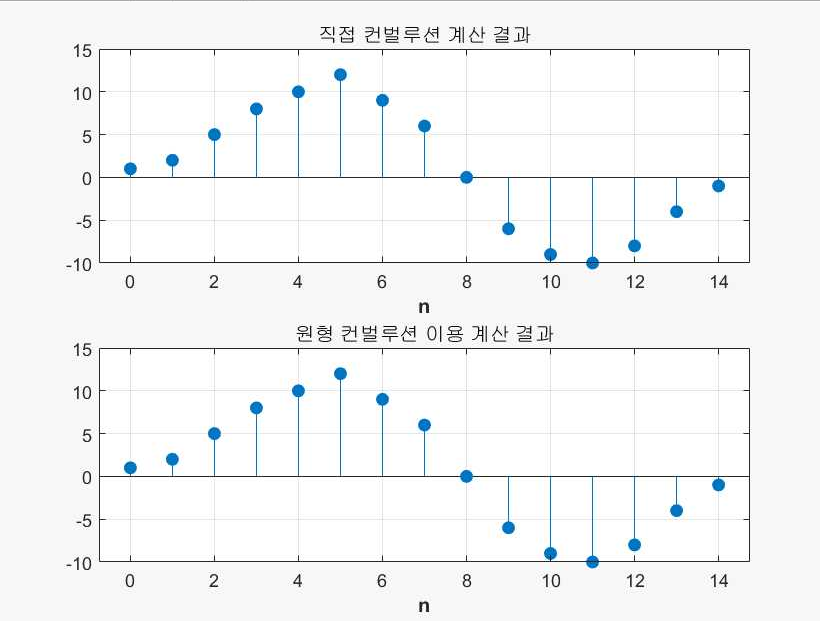

<h1 align="center">Digital Signal Processing</h1>

<p align="center">MATLAB으로 확인한 이산 신호, 필터링, 샘플링, 푸리에 해석</p>

<p align="center">
  
</p>



## Contents

* [프로젝트 소개](#프로젝트-소개)
* [이동평균 필터와 양자화 오차](#이동평균-필터와-양자화-오차)
* [샘플링과 에일리어싱](#샘플링과-에일리어싱)
* [DFT와 원형 컨벌루션](#dft와-원형-컨벌루션)
* [문서](#문서)

## 프로젝트 소개

부경대학교 디지털 신호 처리 수업에서 배운 개념을 MATLAB으로 검산했습니다. 이동평균을 거치면 잡음이 얼마나 줄어드는지, 샘플링 주파수를 바꾸면 스펙트럼이 어떻게 달라지는지, FFT로 선형 컨벌루션을 계산하려면 어떤 조건이 필요한지 그래프로 확인했습니다. 각 스크립트를 MATLAB에서 개별 실행하면 실습 결과를 볼 수 있습니다.

| 주제 | 확인한 내용 | 실습 스크립트 |
| --- | --- | --- |
| 이산 신호 | 임펄스·계단 등 기본 신호, 목표 SNR에 맞춘 백색잡음의 크기 | [DiscreteSignals](01_Signals/DiscreteSignals.m), [NoisySignal](01_Signals/NoisySignal.m) |
| 컨벌루션 | 연속 신호의 적분 근사와 이산 신호의 합, 이동평균을 통한 잡음 감쇠 | [Convolution](02_Convolution/Convolution.m), [MovingAverageFilter](02_Convolution/MovingAverageFilter.m) |
| 샘플링과 양자화 | 샘플링 주파수에 따른 에일리어싱, 진폭 반올림에 따른 오차 | [Sampling](03_Sampling/Sampling.m), [SamplingSpectrum](03_Sampling/SamplingSpectrum.m), [Quantization](03_Sampling/Quantization.m) |
| 푸리에 급수와 DTFT | 주기 신호의 DTFS, DTFT의 대칭과 주파수 이동, FFT·IFFT를 이용한 스펙트럼 계산과 복원 | [DTFS](04_FourierAnalysis/DTFS.m), [DTFT_Inverse](04_FourierAnalysis/DTFT_Inverse.m), [DTFT_Symmetry](04_FourierAnalysis/DTFT_Symmetry.m), [DTFT_FrequencyShift](04_FourierAnalysis/DTFT_FrequencyShift.m) |
| 주파수 영역 컨벌루션 | 스펙트럼의 곱으로 구한 컨벌루션, 영채우기와 원형·선형 컨벌루션의 관계 | [ConvolutionByFT](04_FourierAnalysis/ConvolutionByFT.m), [CircularConvolution](04_FourierAnalysis/CircularConvolution.m) |

## 이동평균 필터와 양자화 오차

지수적으로 증가하는 신호에 주기 8인 코사인 잡음을 더하고, 최근 7개 샘플의 평균을 계산했습니다. 잡음 한 주기의 합은 0이므로 연속된 7개를 더하면 빠진 한 샘플의 부호를 뒤집은 값이 남습니다. 필터 창에 샘플이 7개 모두 들어오는 구간에서 잡음 진폭은 원래의 1/7로 줄어듭니다.

양자화 실습은 진폭이 −1에서 1인 정현파의 샘플을 3비트에 해당하는 간격인 0.25 단위로 반올림합니다. 이 구현은 출력의 양 끝값을 제한하지 않아 가능한 출력값이 9개입니다. 반올림 오차의 절댓값은 간격의 절반인 0.125 이하이고, 원신호와 오차의 에너지 비로 구한 SNR은 약 20.2 dB입니다.

## 샘플링과 에일리어싱

100 Hz 코사인 신호를 75, 100, 125, 400 Hz로 샘플링했습니다. 이 신호를 에일리어싱 없이 샘플링하려면 신호 주파수의 두 배인 200 Hz보다 높은 샘플링 주파수가 필요합니다. 시간 영역 그림의 파란 선은 원신호, 빨간 점은 각 주파수로 얻은 샘플입니다.


각 설정에서 1,024개 샘플을 얻어 FFT로 진폭 스펙트럼을 계산했습니다. 75 Hz와 125 Hz는 원신호의 주파수와 25 Hz 차이이므로, 100 Hz 성분이 ±25 Hz로 접혀 나타납니다. 100 Hz에서는 매 주기의 같은 위상을 읽어 직류 성분인 0 Hz만 나타납니다. 400 Hz에서는 원신호의 주파수 성분이 ±100 Hz에 나타납니다.


## DFT와 원형 컨벌루션

길이가 각각 8인 두 신호의 선형 컨벌루션 결과는 15개 샘플입니다. 두 신호를 길이 8로 DFT해 스펙트럼을 곱한 뒤 역변환하면, 뒤쪽 7개 샘플이 앞쪽에 더해지는 원형 컨벌루션을 얻습니다. 시간 영역에서 직접 접어 더한 결과와 주파수 영역에서 계산한 결과는 `[1 -4 -4 -2 2 8 8 6]`으로 같았습니다.

```matlab
yl = conv(x, h);                        % 선형 컨벌루션 (길이 15)
yc = ylPad(1 : N) + ylPad(N+1 : 2*N);   % 시간 영역: 뒤쪽 샘플을 앞쪽에 접어 더함
yp = ifft(fft(x, N) .* fft(h, N));      % 주파수 영역: 길이 N = 8의 DFT 곱
```


변환 전에 두 신호를 0으로 채워 각각 선형 컨벌루션의 길이 `Nx + Nh - 1` 이상으로 맞추면 뒤쪽 샘플이 앞쪽에 겹치지 않습니다. 실습에서는 길이 15를 사용했고, 그 결과 `conv`로 직접 계산한 선형 컨벌루션과 일치했습니다.



## 문서

* 수업 노트와 실습 설명을 정리했습니다. [개념 정리](Docs/개념%20정리.md)
* 직교 기저를 이용해 푸리에 급수와 푸리에 변환을 유도했습니다. [보고서 PDF](Docs/푸리에%20급수와%20푸리에%20변환%20보고서.pdf)
* 교재 연습문제를 장별로 풀었습니다. [CH2](Docs/문제풀이/CH2%20문제풀이.pdf), [CH3](Docs/문제풀이/CH3%20문제풀이.pdf), [CH4](Docs/문제풀이/CH4%20문제풀이.pdf), [CH5](Docs/문제풀이/CH5%20문제풀이.pdf), [CH6-7](Docs/문제풀이/CH6-7%20문제풀이.pdf)
