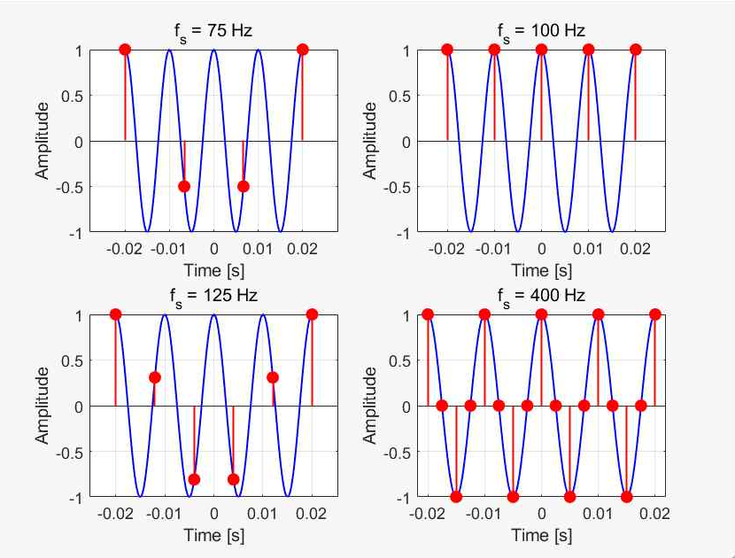
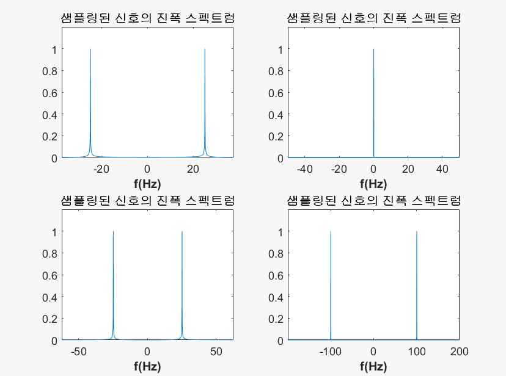
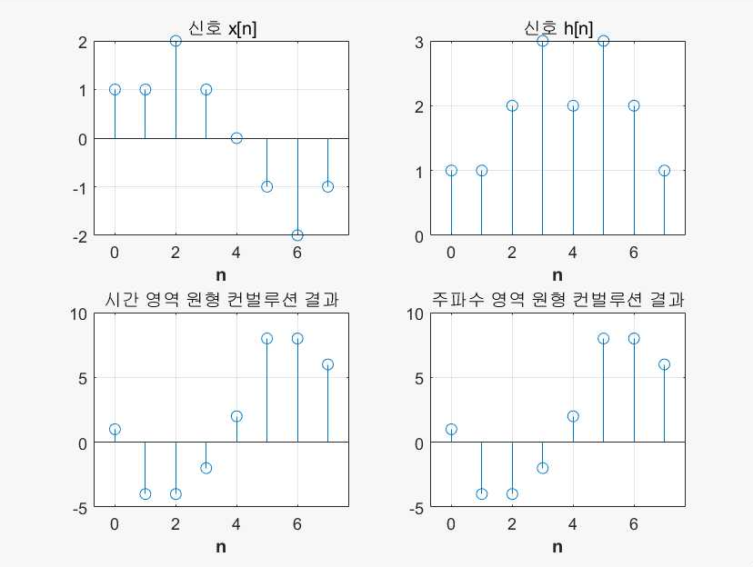

<h1 align="center">Digital Signal Processing</h1>

MATLAB으로 정리한 디지털 신호 처리 실습과 개념 정리

  

## Contents

* [프로젝트 소개](#프로젝트-소개)
* [샘플링과 에일리어싱](#샘플링과-에일리어싱)
* [DFT와 원형 컨벌루션](#dft와-원형-컨벌루션)
* [문서](#문서)

## 프로젝트 소개

부경대학교 디지털 신호 처리 수업을 들으며 작성한 MATLAB 실습, 개념 정리, 교재 연습문제 풀이입니다. 실습은 하나의 주제를 하나의 스크립트로 확인하며, 신호, 컨벌루션, 샘플링, 푸리에 해석 순서로 이어집니다.

<table width="100%">
  <thead>
    <tr>
      <th align="left">주제</th>
      <th align="left">스크립트</th>
      <th align="left">확인한 내용</th>
    </tr>
  </thead>
  <tbody>
    <tr>
      <td>신호</td>
      <td><a href="01_Signals/DiscreteSignals.m">DiscreteSignals</a>, <a href="01_Signals/NoisySignal.m">NoisySignal</a></td>
      <td>기본 이산 신호의 시간 이동, 목표 SNR에 맞춘 잡음 크기 조절</td>
    </tr>
    <tr>
      <td>컨벌루션</td>
      <td><a href="02_Convolution/Convolution.m">Convolution</a>, <a href="02_Convolution/MovingAverageFilter.m">MovingAverageFilter</a></td>
      <td>연속·이산 컨벌루션 비교, 7점 이동평균 필터로 주기 8 잡음 제거</td>
    </tr>
    <tr>
      <td>샘플링</td>
      <td><a href="03_Sampling/Sampling.m">Sampling</a>, <a href="03_Sampling/SamplingSpectrum.m">SamplingSpectrum</a>, <a href="03_Sampling/Quantization.m">Quantization</a></td>
      <td>에일리어싱, 3비트 양자화의 오차 범위와 SNR(약 20.2 dB)</td>
    </tr>
    <tr>
      <td>푸리에 해석</td>
      <td><a href="04_FourierAnalysis/DTFS.m">DTFS</a>, <a href="04_FourierAnalysis/DTFT_Inverse.m">DTFT_Inverse</a>, <a href="04_FourierAnalysis/DTFT_Symmetry.m">DTFT_Symmetry</a>, <a href="04_FourierAnalysis/DTFT_FrequencyShift.m">DTFT_FrequencyShift</a></td>
      <td>실수 신호 스펙트럼의 대칭, 영채우기와 FFT로 DTFT 근사, 주파수 이동</td>
    </tr>
    <tr>
      <td>푸리에 해석</td>
      <td><a href="04_FourierAnalysis/ConvolutionByFT.m">ConvolutionByFT</a>, <a href="04_FourierAnalysis/CircularConvolution.m">CircularConvolution</a></td>
      <td>주파수 영역 곱으로 계산한 컨벌루션, 원형·선형 컨벌루션의 관계</td>
    </tr>
  </tbody>
</table>

각 스크립트는 단독으로 실행되며, 실행하면 결과 그래프가 나옵니다.

## 샘플링과 에일리어싱

100 Hz 정현파 `cos(2π·100t)`를 75, 100, 125, 400 Hz로 샘플링했습니다. 나이퀴스트 정리에 따르면 샘플링 주파수가 200 Hz보다 커야 원래 신호를 복원할 수 있습니다. 시간 영역 그림만으로는 샘플 점이 어떤 주파수를 나타내는지 판단하기 어려워서, 각 샘플 열을 FFT(N = 1024)로 변환해 스펙트럼으로 확인했습니다.

75 Hz와 125 Hz에서는 100 Hz 성분이 ±25 Hz로 접혀 나타납니다. 100 Hz와 75 Hz의 차, 125 Hz와 100 Hz의 차가 모두 25 Hz이기 때문입니다. 100 Hz로 샘플링하면 매 주기 같은 위상에서 값을 읽으므로 신호가 직류(0 Hz)로 보입니다. 400 Hz에서만 ±100 Hz에 원래 주파수가 나타납니다.

## DFT와 원형 컨벌루션

DFT로 두 신호의 스펙트럼을 곱하면 선형 컨벌루션이 아니라 원형 컨벌루션이 계산됩니다. 길이 8인 두 신호 `x = [1 1 2 1 0 -1 -2 -1]`, `h = [1 1 2 3 2 3 2 1]`로 이 관계를 확인했습니다.

원형 컨벌루션을 두 가지로 계산했습니다. 시간 영역에서는 길이 15인 선형 컨벌루션 결과를 길이 8로 접어 `y[n] + y[n+8]`을 더하고, 주파수 영역에서는 `ifft(fft(x) .* fft(h))`를 계산합니다. 두 결과는 `[1 -4 -4 -2 2 8 8 6]`으로 같습니다. 선형 컨벌루션의 뒷부분이 앞부분에 겹쳐 더해진 것입니다.

겹침을 없애려면 두 신호를 선형 컨벌루션의 길이인 `Nx + Nh - 1 = 15`까지 0으로 채운 뒤 DFT를 적용합니다. 접힐 부분이 없으므로 원형 컨벌루션 결과가 `conv`로 직접 계산한 선형 컨벌루션과 같아집니다. FFT로 긴 신호의 컨벌루션을 빠르게 계산할 때 영채우기가 필요한 이유입니다.

## 문서

* [개념 정리](Docs/개념%20정리.md): 수업 노트를 실습 순서에 맞춰 다시 정리한 문서
* [푸리에 급수와 푸리에 변환 보고서](Docs/푸리에%20급수와%20푸리에%20변환%20보고서.pdf): 직교 기저에서 푸리에 급수와 푸리에 변환을 유도한 보고서
* 교재 연습문제 손풀이: [CH2](Docs/문제풀이/CH2%20문제풀이.pdf), [CH3](Docs/문제풀이/CH3%20문제풀이.pdf), [CH4](Docs/문제풀이/CH4%20문제풀이.pdf), [CH5](Docs/문제풀이/CH5%20문제풀이.pdf), [CH6-7](Docs/문제풀이/CH6-7%20문제풀이.pdf)
